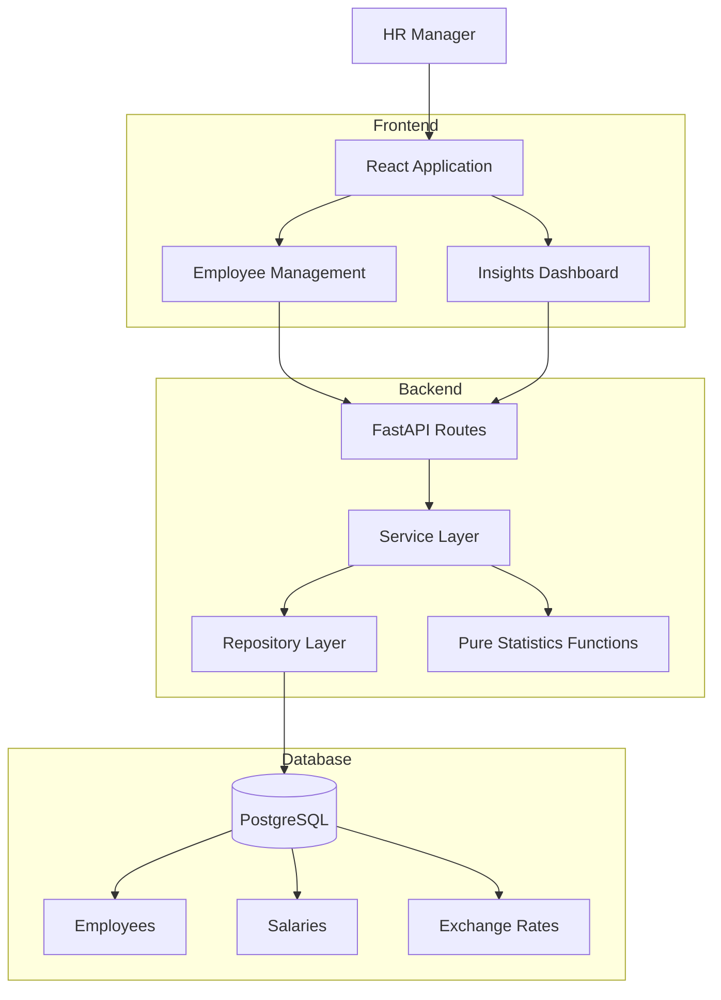

# Salary Management — Design

## 1. Overview

ACME Salary Management is a full-stack application designed to replace spreadsheet-based employee and salary management.

It provides employee CRUD functionality, append-only salary history, and organizational salary analytics.

The application uses a React frontend, FastAPI backend, and PostgreSQL database.

## 2. Technology Stack

| Layer | Technology |
|---|---|
| Frontend | React, Vite, TypeScript |
| UI | Material UI |
| Data fetching | TanStack Query |
| Charts | Recharts |
| Backend | Python, FastAPI |
| Validation | Pydantic v2 |
| ORM | SQLAlchemy 2.x |
| Migrations | Alembic |
| Database | PostgreSQL 15+ |
| Backend testing | pytest, httpx |
| Frontend testing | Vitest, React Testing Library |
| Local infrastructure | Docker Compose |

## 3. High-Level Architecture

## 4. Data Model

### Employees

Stores the employee's identity and employment information.

Main fields:
- id
- full_name
- email
- job_title
- department
- country
- employment_type
- hire_date
- created_at
- updated_at

### Salaries

Stores annual gross salary records.

Main fields:
- id
- employee_id
- amount
- currency
- effective_from
- created_at

Salary records are append-only. The current salary is selected using the latest effective_from date.

### Exchange Rates

Stores static conversion rates.

Main fields:
- currency
- rate_to_base

USD is the base currency.

## 5. Backend Layering

### Routes

Handle HTTP requests, validate input through Pydantic schemas, call services, and return responses.

### Services

Contain business logic, employee operations, salary history management, currency conversion orchestration, and analytics.

### Repositories

Contain database access, SQL queries, filtering, grouping, sorting, pagination, and aggregate calculations.

### Pure Functions

Statistical functions will be kept independent of database access so they can be tested directly.

## 6. Key Application Flows

### Employee management

To be documented during employee API and frontend implementation.

### Salary updates

To be documented during salary history implementation.

### Analytics

To be documented during analytics implementation.

## 7. Database and Performance

- Use PostgreSQL for data persistence.
- Store money using NUMERIC and Python Decimal.
- Perform pagination and analytical aggregation in PostgreSQL.
- Add indexes for frequently filtered and queried employee fields.
- Avoid loading the entire employee dataset into application memory or the browser.

Detailed index decisions and performance measurements will be added as implementation progresses.

## 8. Trade-offs

Detailed design decisions will be recorded in docs/decisions.md.

Initial principles:
- Prefer a simple layered architecture over unnecessary abstractions.
- Preserve salary history rather than overwriting salary records.
- Use fixed exchange rates to ensure deterministic analytics.
- Keep analytical queries in PostgreSQL.
- Introduce additional infrastructure only when required.

## 9. Deployment

The planned deployment uses:
- A containerized FastAPI backend.
- Managed PostgreSQL.
- A separately deployed React frontend.
- Environment-based configuration.

Exact deployment configuration and instructions will be added during the deployment stage.
